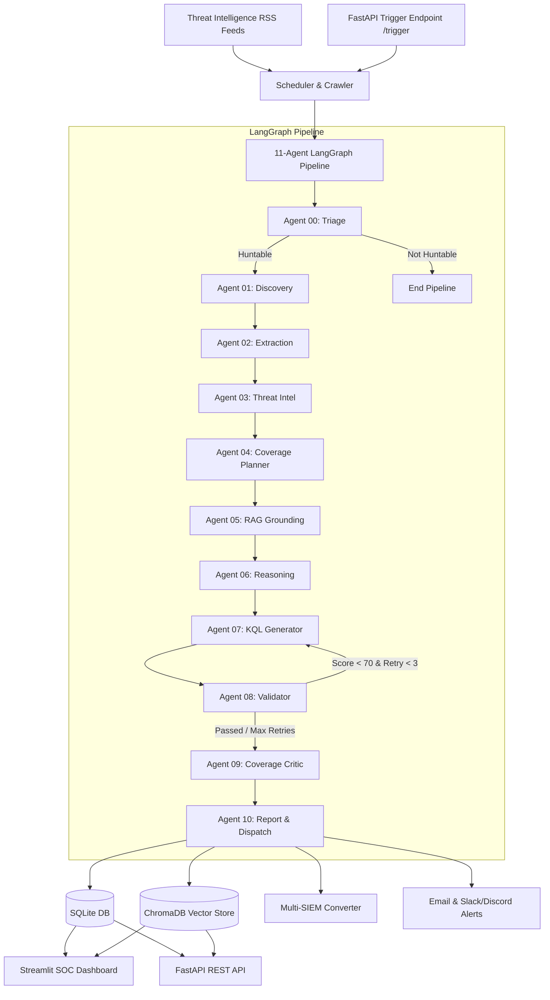

# ThreatMind

Autonomous Cyber Threat Intelligence & SOC Orchestration Platform

[](https://www.python.org/)
[](https://fastapi.tiangolo.com/)
[](https://streamlit.io/)
[](https://www.langchain.com/langgraph)
[](https://www.trychroma.com/)

---

## 1. Project Overview

**ThreatMind** is an enterprise-grade autonomous cyber threat intelligence (CTI) pipeline and Security Operations Center (SOC) orchestration platform. It automates the complete intelligence lifecycle: continuously scraping CTI feeds, extracting MITRE ATT&CK tactics, techniques, and Indicators of Compromise (IOCs), synthesizing grounded Microsoft Sentinel KQL queries, validating rule syntax against real table schemas, converting detection rules into cross-platform SIEM formats (Splunk, Elastic, QRadar, Wazuh, SentinelOne, CrowdStrike), and delivering alerts to SOC teams.

---

## 2. Features

- **11 Autonomous LangGraph Agents**: Modular stateful multi-agent execution pipeline.
- **Intelligent Threat Triage**: Filters non-huntable articles early to optimize LLM token efficiency.
- **Hybrid RAG Retrieval**: Semantic vector retrieval from ChromaDB grounded in official Microsoft Sentinel schemas and historical KQL patterns.
- **Self-Healing KQL Validation**: Automated validator with a retry loop (up to 3 retries) and intelligent column auto-correction (e.g., `CommandLine` → `ProcessCommandLine`).
- **Multi-SIEM Translation**: Converts Sentinel KQL into **Splunk SPL**, **Elasticsearch Lucene**, **IBM QRadar AQL**, **Wazuh XML**, **SentinelOne**, and **CrowdStrike LogScale**.
- **Multi-Channel Alerting**: Instant HTML email summaries and Slack/Discord webhook alerts for `HIGH` and `CRITICAL` threats.
- **RESTful API & SOC Dashboard**: Fully documented FastAPI server paired with an interactive Streamlit SOC dashboard.
- **SSRF & Security Safeguards**: Built-in safeguards against private IP, loopback, link-local, and SSRF targets.

---

## 3. Architecture



---

## 4. 11-Agent Pipeline

| Agent | Name | Responsibilities |
| :--- | :--- | :--- |
| **00** | **Triage** | Determines whether an article contains actionable/huntable threat intelligence; fails closed if irrelevant. |
| **01** | **Discovery** | Downloads raw HTML with rotated User-Agents, configurable timeouts, and exponential retries. |
| **02** | **Extraction** | Cleans HTML by stripping non-content elements and extracts sanitized title, date, and body text. |
| **03** | **Threat Intel** | Extracts MITRE ATT&CK tactics, techniques, malware families, threat actors, and IOCs (IPs, domains, hashes). |
| **04** | **Coverage Planner** | Formulates multi-angle detection strategies mapped to Sentinel tables (`DeviceProcessEvents`, `DeviceNetworkEvents`, etc.). |
| **05** | **RAG** | Grounding layer performing semantic vector retrieval for table schemas, past threat reports, and KQL patterns. |
| **06** | **Reasoning** | Correlates behaviors, IOCs, and table/column mappings without exposing internal Chain-of-Thought in public API output. |
| **07** | **KQL Generator** | Synthesizes precise Microsoft Sentinel KQL detection and hunting queries based on schema context. |
| **08** | **Validator** | Scores queries against syntax rules and auto-corrects legacy column names. Triggers retry loop if score < 70. |
| **09** | **Coverage Critic** | Compares generated rules against threat behaviors, identifies gaps, and assigns severity (`CRITICAL`, `HIGH`, `MEDIUM`, `LOW`). |
| **10** | **Report & Dispatch** | Produces executive summary reports, invokes multi-SIEM translation, persists data, and dispatches alerts. |

---

## 5. RAG Architecture

ThreatMind uses a hybrid RAG architecture backed by ChromaDB vector collections:

- **Collection `sentinel_schema`**: Stores indexed column metadata and table schema definitions for exact syntax grounding.
- **Collection `kql_library`**: Stores historical high-performing KQL patterns indexed by technique and behavior.
- **Collection `threat_intel`**: Embedded past threat intelligence reports for contextual similarity matching.

---

## 6. Microsoft Sentinel KQL Generation

The KQL generation engine creates targeted detection rules based on extracted MITRE ATT&CK techniques:

```kusto
DeviceProcessEvents
| where TimeGenerated >= ago(1d)
| where ProcessCommandLine has_any ("powershell.exe", "-enc", "DownloadString")
| project TimeGenerated, DeviceName, AccountName, ProcessCommandLine, InitiatingProcessFileName
```

---

## 7. KQL Validation

Agent 08 performs automatic scoring and schema validation:

- **Syntax Gate**: Validates pipe operators (`|`), time filters (`TimeGenerated`), and search conditions.
- **Column Auto-Corrector**: Automatically remaps legacy column names (e.g., `CommandLine` → `ProcessCommandLine`, `ParentProcess` → `InitiatingProcessFileName`).
- **Validation Retry Loop**: If a query scores below `70`, it is routed back to Agent 07 for re-generation (up to 3 retries).

---

## 8. Multi-SIEM Conversion

ThreatMind converts Sentinel KQL rules into 6 destination SIEM formats:

- **Splunk SPL**: Native pySigma translation (`index=* sourcetype=...`)
- **Elasticsearch Lucene**: Lucene syntax for Elastic Security
- **IBM QRadar AQL**: AQL `SELECT` queries
- **CrowdStrike LogScale**: Falcon LogScale / Humio syntax
- **Wazuh**: Structured `<rule>` XML blocks for `ossec.conf`
- **SentinelOne**: Deep Visibility event queries

---

## 9. FastAPI API

FastAPI provides administrative telemetry and pipeline control endpoints:

```bash
# Start API Server
uvicorn api.main:app --host 0.0.0.0 --port 8000
```

- **Docs**: `http://localhost:8000/docs`
- **Liveness**: `http://localhost:8000/health`
- **Readiness**: `http://localhost:8000/ready`

---

## 10. Streamlit SOC Dashboard

The SOC Dashboard is organized into 5 dedicated views:

1. **Live Feed**: Real-time RSS crawler monitoring, feed controls, and manual pipeline triggers.
2. **Threat Details**: Threat intelligence reports, extracted IOCs, and severity badges.
3. **Queries**: Multi-platform query inspection (Sentinel KQL, Splunk SPL, Elastic, QRadar, Wazuh, SentinelOne).
4. **Statistics**: SOC metrics, validation score distributions, and table coverage charts.
5. **KQL Library**: Semantic vector search engine for historical detection rules.

---

## 11. Alerting

- **SMTP Email**: HTML-formatted threat reports containing executive summaries, severity badges, and links to the SOC Dashboard.
- **Slack & Discord Webhooks**: Structured block message notifications sent immediately when a `HIGH` or `CRITICAL` threat is processed.

---

## 12. Installation

```bash
# 1. Clone repository
git clone https://github.com/HurairaMaqbool/ThreatMind.git
cd ThreatMind

# 2. Create virtual environment
python -m venv venv
source venv/bin/activate  # On Windows: venv\Scripts\activate

# 3. Install dependencies
pip install -r requirements.txt

# 4. Copy environment configuration
cp .env.example .env
```

---

## 13. Environment Variables

Configure `.env` with your API keys and server options:

```ini
# Required LLM Credentials
GROQ_API_KEY=gsk_your_groq_api_key_here
GROQ_MODEL=llama-3.3-70b-versatile

# Storage Paths
DATABASE_PATH=data/autothreat.db
CHROMA_PATH=chroma_db

# Alerting
SMTP_HOST=smtp.gmail.com
SMTP_PORT=587
SMTP_USERNAME=alerts@company.com
SMTP_PASSWORD=your_app_password
ALERT_EMAIL_FROM=threatmind@company.com
ALERT_EMAIL_TO=soc@company.com

SLACK_WEBHOOK_URL=https://hooks.slack.com/services/xxx/yyy/zzz
DISCORD_WEBHOOK_URL=https://discord.com/api/webhooks/xxx/yyy

# Server Config
API_HOST=0.0.0.0
API_PORT=8000
DASHBOARD_URL=http://localhost:8501
MIN_VALIDATION_SCORE=70
MAX_VALIDATION_RETRIES=3
```

---

## 14. Local Development

```bash
# 1. Verify system preflight status
python scripts/preflight.py

# 2. Run REST API
uvicorn api.main:app --host 0.0.0.0 --port 8000 --reload

# 3. Run SOC Dashboard
streamlit run dashboard/app.py --server.port 8501
```

---

## 15. Docker Deployment

```bash
# Start all services (API + Dashboard)
docker-compose up -d --build

# View container logs
docker-compose logs -f

# Stop containers
docker-compose down
```

---

## 16. API Endpoints

| Method | Endpoint | Description |
| :--- | :--- | :--- |
| `GET` | `/health` | Liveness check returning system operational status. |
| `GET` | `/ready` | Deep readiness probe checking SQLite & ChromaDB health. |
| `GET` | `/stats` | Telemetry statistics on threats, queries, and vector records. |
| `GET` | `/threats` | List all threat intelligence reports with pagination. |
| `GET` | `/threats/{id}` | Retrieve specific threat report and associated SIEM rules. |
| `GET` | `/queries` | Filter generated queries by platform or threat ID. |
| `GET` | `/kql/{angle_id}` | Fetch specific KQL detection rule from vector library. |
| `POST` | `/trigger?url=` | Asynchronously run 11-agent pipeline on target blog URL. |

---

## 17. Testing

Run the full automated test suite:

```bash
# Run unit tests via unittest
python -m unittest discover tests -v

# Or run via pytest
pytest tests -v
```

---

## 18. Security Considerations

- **SSRF Prevention**: `/trigger` validates URLs, blocking loopback (`127.0.0.1`, `localhost`), private IPv4 spaces (`10.0.0.0/8`, `172.16.0.0/12`, `192.168.0.0/16`), and link-local addresses.
- **API Key Protection**: Secrets are loaded via environment variables (`.env`). `.env` is listed in `.gitignore`.
- **Defensive Static Analysis**: ThreatMind is purely defensive; it performs static analysis of text feeds and never executes sample binaries or payloads.

---

## 19. Project Structure

```
ThreatMind/
├── agents/
├── alerts/
├── api/
├── config/
├── dashboard/
├── memory/
├── pipeline/
├── scheduler/
├── scripts/
├── tests/
├── utils/
├── .env.example
├── .gitignore
├── Dockerfile
├── docker-compose.yml
├── README.md
└── requirements.txt
```

---

## 20. Future Improvements

- Integration with STIX 2.1 / TAXII feeds.
- Automated Sentinel ARM template / Bicep deployment generation.
- Real-time SIEM live query validation against Microsoft Defender XDR APIs.
- SOAR playbook auto-generation (Azure Logic Apps / Cortex XSOAR).
